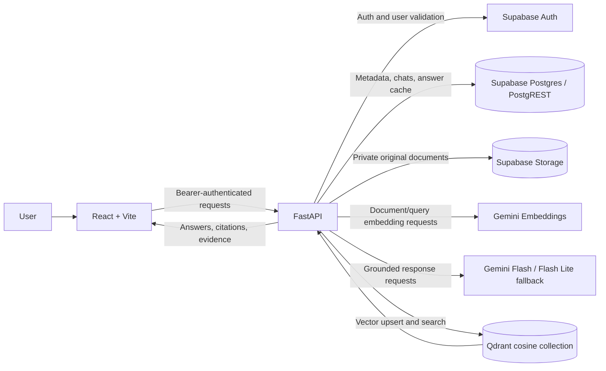
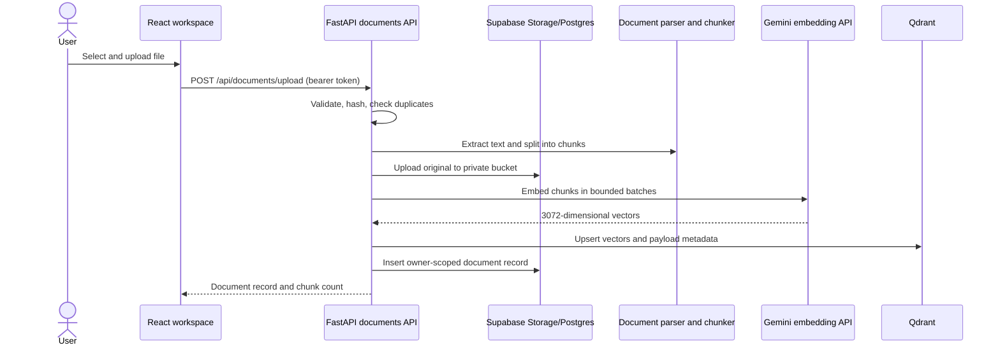


# System Design — Production RAG Service

## 1. Overview

The Production RAG Service is a document question-answering application built using a code-based Retrieval-Augmented Generation architecture.

The system processes uploaded documents, converts their text into embeddings, stores those embeddings in a persistent vector database, and retrieves relevant evidence in response to user questions.

The application prioritizes traceability by returning source citations and retrieved chunks. It abstains when retrieved evidence does not meet the configured similarity threshold.

## 2. Technology Choices

| Component | Current implementation |
|---|---|
| Backend | Python 3.11, FastAPI, Uvicorn |
| Frontend | React, Vite, React Router |
| Primary answer model | Google Gemini Flash; code and Render default ID: `gemini-3.8-flash` |
| Fallback answer model | Google Gemini Flash Lite; default ID: `gemini-3.5-flash-lite` |
| Embedding model | Google Gemini `gemini-embedding-001` |
| Embedding dimensions | 3072 |
| Vector database | Qdrant, collection `rag_documents_gemini_001` |
| Similarity | Qdrant cosine distance; API exposes a bounded similarity score |
| Backend services | Supabase Auth, Postgres/PostgREST with RLS, and private Storage |
| Text extraction | PyPDF, python-docx, python-pptx, UTF-8 reads for TXT/Markdown |
| HTTP client | HTTPX for Supabase REST calls |
| Tests | Pytest |

## 3. System Architecture

The backend uses Supabase's HTTP APIs through HTTPX; it does not use a
service-role key or a Supabase Python SDK. The browser sends API calls to
FastAPI, which validates the bearer token with Supabase Auth before performing
user-scoped operations.

Model IDs are configurable at runtime. The code defaults and Render Blueprint
select `gemini-3.8-flash` and `gemini-3.5-flash-lite`; the checked-in local
environment example selects a different primary model. The actual value in a
private `.env` or live Render environment was not inspected. The embedding
model can also be overridden; the code and Render default is
`gemini-embedding-001`.

## 4. Document Ingestion

The authenticated upload endpoint accepts PDF, DOCX, PPTX, TXT, and Markdown
files up to 15 MB. It computes a SHA-256 hash and checks for duplicates for the
current user in both Supabase document metadata and Qdrant payloads.

The loader uses PyPDF to extract PDF pages, python-docx for paragraphs and
tables (assigned page 1 because physical page numbers are unavailable), and
python-pptx for slide text and table cells. TXT and Markdown are read as UTF-8.
Files with no extractable text are rejected; there is no OCR path for image-only
documents.

Each extracted page/slide is split independently. Chunk payload metadata
includes the document ID, filename, page/slide number, chunk position, user ID,
and file hash. Document embeddings use Gemini task type
`RETRIEVAL_DOCUMENT`, in batches of at most 64 chunks. The original file is
uploaded to private Supabase Storage, vectors are upserted into Qdrant, and the
document record is inserted into Supabase Postgres. Later-stage failures invoke
best-effort cleanup of any vector points and storage object already written.

Upload processing is synchronous in the API request; no durable background
worker or job queue is implemented. The frontend runs at most two file uploads
concurrently.

## 5. Chunking Strategy

The default configuration is:

- Chunk size: 800 characters
- Chunk overlap: 150 characters

Overlap preserves context across chunk boundaries. The production API uses the
800/150 configuration. Chunking and embedding are performed in the upload
request, not in a background job.

Two configurations were experimentally compared:

| Metric | Configuration A | Configuration B |
|---|---:|---:|
| Chunk size | 800 | 500 |
| Overlap | 150 | 100 |
| Total chunks | 863 | 1,313 |
| Hit Rate@5 | 100% | 100% |
| Recall@5 | 100% | 90% |
| MRR | 0.6667 | 0.7067 |
| Average retrieval latency | 0.0208 sec | 0.1265 sec |

The historical result files compare these configurations, but their recorded
measurements predate the current Gemini embedding migration. They are not
evidence of current Gemini retrieval quality or latency; see `EVAL.md` for
scope and caveats.

## 6. Embedding and Answer Models

| Role | Model ID | Use |
|---|---|---|
| Document and query embeddings | `gemini-embedding-001` | `RETRIEVAL_DOCUMENT` and `RETRIEVAL_QUERY` vectors |
| Primary answer generation | `gemini-3.8-flash` | Grounded answer generation by code/Render default |
| Fallback answer generation | `gemini-3.5-flash-lite` | Attempted after retryable primary-model API failures |

Model IDs are environment-configurable, so the actual selected runtime value
cannot be proven without the private environment configuration. The checked-in
local environment example sets a different primary model than the code and
Render defaults. Embeddings returned by the configured model are checked to
contain exactly 3072 values before they can be stored.

The Gemini client uses a 30-second request timeout and disables SDK-level
automatic retries; application-level pacing and retry behavior is described in
Section 13. Source passages are sent to Gemini for answer generation, so
service availability, quota, cost, and data handling depend on Google.

## 7. Vector Database Selection

The active API uses Qdrant. Its collection is named
`rag_documents_gemini_001` and is configured with 3072-dimensional vectors and
`Distance.COSINE`. The service creates that collection if it is absent; it does
not migrate or transform an existing collection. Production uses a configured
Qdrant endpoint and API key. Local development uses embedded persistent Qdrant
when no endpoint is configured; tests use an in-memory client.

Each point stores the chunk text and metadata including user and document IDs.
The hosted collection creates keyword payload indexes for `document_id`,
`user_id`, and `file_hash`. Searches include a mandatory user filter and may
also filter to selected document IDs. Re-index documents if changing embedding
model or dimension; vectors from different embedding spaces must not be mixed.

## 8. Retrieval Strategy

Questions default to five candidates (`top_k` is limited to ten). Gemini embeds
the query using task type `RETRIEVAL_QUERY`; Qdrant performs cosine search
filtered to the authenticated user and optional selected document IDs. The
returned Qdrant score is exposed as a similarity score clamped to the range
0–1, while `distance` is reported as one minus that score.

The API keeps matches whose similarity meets the code-configured threshold of
0.30. If none remain, it returns an abstention without calling the answer
model. Similarity is a retrieval signal, not a calibrated probability or proof
that a passage answers the question. The historical threshold experiments in
`EVAL.md` do not establish current Gemini performance.

## 9. Answer Generation and Grounding

The primary Gemini Flash model receives the question and retrieved passages
with a system instruction to answer only from those passages, treat passage
text as untrusted data, avoid unsupported facts, and abstain plainly when the
sources do not answer. For retryable API errors from the primary model, the
configured Gemini Flash Lite model is attempted. This fallback does not apply
to every possible configuration or validation error.

For chat follow-ups, recent turns are used only to resolve references; they are
not treated as evidence. Citations are built separately from retrieved
metadata, with filename, page/slide, chunk position, and similarity. The API
returns the generated answer, citations, retrieved chunks, abstention status,
and structural answer-evaluation checks.

The answer is generated by Gemini from retrieved sources. The prompt,
threshold, and citations do not guarantee semantic faithfulness. The answer
evaluation checks completeness, source presence, and citation presence; it is
not an automated semantic grounding judge.

## 10. Supabase, Authentication, and Data Ownership

The backend communicates with Supabase Auth, Postgres/PostgREST, and Storage
through HTTPX. Protected FastAPI routes require a bearer access token, which is
validated with Supabase Auth. The frontend stores access and refresh tokens in
browser local storage and attempts a refresh after an API 401 response.

| Supabase resource | Purpose |
|---|---|
| Auth | Registration, login, refresh, password recovery, password update, and validation of access tokens |
| `documents` | Per-user document metadata and duplicate-file hashes |
| `question_cache` | Per-user cached question responses and retrieved evidence |
| `chat_sessions` | Per-user chat titles and timestamps |
| `chat_turns` | Questions, answers, citations, retrieved chunks, selected document IDs, and abstention state |
| Private Storage bucket | Original uploaded document bytes |

`supabase/schema.sql` defines the tables, grants, row-level security policies,
storage bucket policies, and cache-clearing triggers. The chat migration is
available for existing projects that already have the document tables. API
operations use the user's token with the publishable key; no service-role key
is needed by the application. Qdrant search and delete operations also filter
on the authenticated user's ID.

The response cache key includes a normalized question, selected document IDs,
recent chat context, and `top_k`; the Supabase row is keyed by user, question
hash, and `top_k`. Database triggers clear a user's cache when a document row
is inserted or deleted. Chat history is loaded and saved only when a chat ID is
provided.

## 11. Guardrails and Validation

Implemented checks include:

- Question length and non-empty validation.
- Basic detection of known prompt-injection phrases in the question.
- File extension, non-empty content, and file-size validation.
- SHA-256 duplicate detection in Supabase metadata and Qdrant.
- User-scoped retrieval and optional selected-document filters.
- Similarity-based abstention and citations derived from retrieved metadata.
- Upload rollback attempts when later indexing or persistence steps fail.
- RLS-protected Supabase records and private-storage folder policies.

The phrase filter is a basic defense, not a complete defense against indirect
prompt injection, malicious documents, or novel attacks. RLS and Storage
policies must be installed from the Supabase schema before deployment.

## 12. API Error Handling

The API uses structured HTTP responses:

| Status | Example behavior |
|---|---|
| 200 | Successful list, chat read, or question response |
| 201 | Document upload or chat creation |
| 204 | Document or chat deletion |
| 400 | Invalid question, empty file, or prompt-pattern rejection |
| 401 | Missing or invalid Supabase bearer token |
| 404 | Requested document or chat does not exist |
| 409 | Duplicate document or account |
| 413 | Upload exceeds the configured file-size limit |
| 415 | Unsupported document extension |
| 422 | Invalid request schema or field constraints |
| 429 | API/Gemini/Supabase rate limit; `Retry-After` may be present |
| 500 | Unexpected processing failure |
| 503 | Supabase, Qdrant, or Gemini dependency unavailable |

Error responses avoid returning internal exception details. Document and
question endpoints translate external-service failures into controlled HTTP
responses.

## 13. Rate Limiting and Retries

There are two distinct forms of rate control:

- FastAPI middleware limits API requests by client IP in a per-process
  in-memory window and returns HTTP 429 with `Retry-After` when exceeded.
- `RequestPacer` serializes Gemini request starts separately for embeddings
  and for each answer model. Its RPM and retry/backoff settings are
  environment-configurable and apply to one backend process only.

The Gemini client disables SDK retries. Application retries use bounded
exponential backoff with jitter for selected transient HTTP statuses, honoring
provider retry hints when within the configured maximum wait. An embedding
quota error becomes HTTP 429 and includes `Retry-After` when Gemini provides a
retry delay; longer provider hints are returned immediately rather than holding
the upload request open. Retryable primary answer-model failures can trigger
the configured Flash Lite fallback. This pacing cannot override a provider's
daily quota or coordinate limits across multiple Render instances.

## 14. Logging and Observability

FastAPI middleware logs a request ID, HTTP method, path, status, and latency;
the request ID is returned in `X-Request-ID`. Processing logs document IDs,
user IDs, counts, and service failure details without intentionally logging
document contents or credentials. Centralized metrics, tracing, and alerting
are not implemented.

The `/health` endpoint reports application health only; it does not probe
Gemini, Qdrant, or Supabase.

## 15. Evaluation

The evaluation framework uses a 25-question golden dataset: 20 answerable and
five unanswerable questions. Five questions have manually verified retrieval
labels. It calculates Hit Rate@K, Recall@K, MRR, abstention counts, and
retrieval latency, and can compare chunking configurations.

The checked-in result artifacts are historical and predate the current Gemini
embedding migration. They do not measure current Gemini retrieval quality or
latency. `EVAL.md` documents the dataset, page-level relevance proxy, and
limitations. Runtime answer evaluation checks non-empty output and source/
citation presence, or expected abstention structure; it does not prove semantic
faithfulness or factual correctness.

## 16. Runtime and Deployment

The Render Blueprint uses a single Docker web service. The Dockerfile builds
the React/Vite frontend with Node and runs FastAPI on Python 3.11, serving the
built single-page app and API from one origin. Uvicorn is configured with one
worker, and `/health` is the configured health-check path. Production requires
configured Gemini, hosted Qdrant, and Supabase settings; the Supabase SQL
schema must be applied separately.

Local development uses embedded persistent Qdrant when no hosted URL is
configured. Test mode uses in-memory Qdrant. Production documents, metadata,
chat history, and vectors are stored in Supabase and hosted Qdrant rather than
the container filesystem.

## 17. Current Limitations

- Upload parsing, embedding, and vector writes run synchronously in the
  request path; there is no durable job queue or background worker.
- Image-only PDFs are not OCR-processed.
- Similarity threshold calibration for a production corpus remains necessary.
- Generated answers can still contain unsupported claims despite the grounded
  prompt and separately constructed citations.
- Prompt-injection pattern checks are incomplete.
- Evaluation relevance labels and historical results are limited and do not
  characterize the current embedding configuration.
- Gemini quota and retry pacing are per process; they do not increase provider
  quotas or enforce a global limit across multiple instances.
- Centralized monitoring and semantic answer evaluation are not implemented.

## 18. Future Improvements

- Stronger prompt-injection defenses
- Expanded golden evaluation dataset
- Semantic answer-quality evaluation
- Durable background ingestion with job status and retry persistence
- Shared rate limiting if scaling to multiple backend processes
- Centralized monitoring, metrics, and alerting
