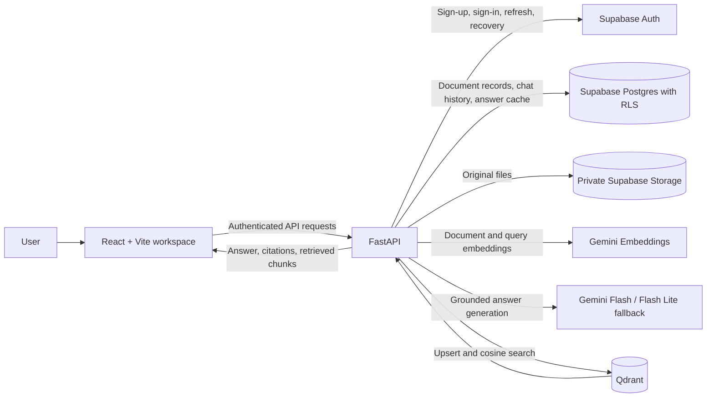

# Production RAG Service

A document-based Retrieval-Augmented Generation (RAG) application that allows users to upload documents, ask questions, retrieve relevant evidence, and receive source citations.

Built with FastAPI, React, Gemini, Qdrant, and Supabase.

## Project Overview

This project implements a code-based RAG pipeline for document question answering.

Users can upload supported documents, process their content into overlapping chunks, generate embeddings, store them in Qdrant, and ask questions against the uploaded collection.

The system uses similarity-based retrieval and abstains when retrieved evidence does not meet the configured relevance threshold.

## Features

- PDF, DOCX, PPTX, TXT, and Markdown document support
- Document text extraction and chunking
- Gemini embeddings (`gemini-embedding-001`) and grounded answer generation
- Gemini Flash Lite fallback for retryable primary-model generation errors
- Hosted Qdrant for production (embedded Qdrant for local development)
- Supabase Auth, RLS-protected Postgres document metadata, and private Storage
- Supabase-backed per-user chat history, follow-up context, and per-turn document source selection
- Email-based Supabase password recovery
- Duplicate detection across Supabase metadata and Qdrant vectors
- Per-user, top-k answer caching in Supabase, cleared when a document is added or deleted
- Search scoped to selected documents
- Semantic similarity retrieval
- Source citations and retrieved chunk inspection
- Similarity-based abstention
- SHA-256 duplicate detection
- Document listing and deletion
- React frontend
- 25-question golden evaluation dataset
- Retrieval metric calculations
- Chunking and similarity threshold experiments
- Request ID and latency logging
- API documentation through Swagger

## Technology Stack

| Component | Technology |
|---|---|
| Backend | Python 3.11, FastAPI, Uvicorn |
| Frontend | React, Vite |
| Primary answer model | Google Gemini Flash (`gemini-3.8-flash` in code and Render defaults) |
| Fallback answer model | Google Gemini Flash Lite (`gemini-3.5-flash-lite`) |
| Embedding model | Google `gemini-embedding-001`, 3072 dimensions |
| Vector database | Qdrant; collection `rag_documents_gemini_001`, cosine distance |
| Backend services | Supabase Auth, Postgres through REST with RLS, and private Storage |
| Document processing | PyPDF, python-docx, python-pptx, UTF-8 text/Markdown |
| Testing | Pytest |

Model IDs are environment-configurable. The primary model in the checked-in
local environment example differs from the code and Render defaults; the
effective model in a private local `.env` or deployed Render service cannot be
confirmed from source alone. The configured embedding model can also be
overridden at runtime.

## Architecture



### Document ingestion

1. The authenticated upload endpoint validates the extension and the 15 MB
   per-file limit, reads the file, computes its SHA-256 hash, and checks for a
   duplicate for that user.
2. PyPDF extracts PDF text by page; python-docx extracts paragraphs and tables;
   python-pptx extracts slide text and tables; TXT and Markdown are read as
   UTF-8. Image-only PDFs are not OCR-processed.
3. Extracted page/slide text is split into 800-character chunks with 150
   characters of overlap. Each chunk retains its page/slide and position.
4. The original is uploaded to the private Supabase Storage bucket.
5. Gemini `gemini-embedding-001` embeds chunks in batches of up to 64. The
   service checks the number and 3072-dimensional size of returned vectors.
6. Qdrant stores each vector with its text and owner/document metadata.
   Supabase Postgres stores the document record. The API attempts to roll back
   uploaded storage objects and vectors if a later indexing/persistence step
   fails.

Uploads are processed in the request; there is no background job queue. The
frontend can upload up to two selected files concurrently.

### Question and answer flow

1. FastAPI validates the question and bearer token. A question may specify a
   chat session and a subset of the user's document IDs.
2. If a chat is active, saved turns are loaded. The API checks the per-user
   answer cache using the normalized question, selected documents, conversation
   context, and `top_k`.
3. On a cache miss, Gemini creates a `RETRIEVAL_QUERY` embedding. Qdrant search
   is filtered by user ID and, when supplied, selected document IDs. The
   default is five results; the API accepts up to ten.
4. Results below the configured cosine-similarity threshold are excluded. If
   no relevant chunk remains, the API abstains instead of generating an answer.
5. Gemini Flash generates an answer using only the retrieved passages. For
   retryable primary-model API failures, Gemini Flash Lite is attempted as a
   fallback. Citations are built separately from retrieved chunk metadata.
6. The answer, citations, retrieved chunks, and structural answer checks are
   returned. When a chat is active, the turn is saved in Supabase; the response
   is also cached.

### Supabase responsibilities

The backend calls Supabase Auth, Postgres REST (PostgREST), and Storage over
HTTP. It does not use a Supabase service-role key. Authenticated API calls are
validated with Supabase Auth and use the user's bearer token. Postgres stores
document metadata, chat sessions/turns, and cached question responses; the
private Storage bucket stores originals. The SQL schema configures row-level
security and owner-scoped storage policies. Database triggers clear a user's
answer cache when that user's document row is inserted or deleted.

See [DESIGN.md](DESIGN.md) for architecture and design decisions.

## Installation

### 1. Clone the repository

```bash
git clone https://github.com/Mary-star-coder/IEC-Production-RAG--Services.git
cd IEC-Production-RAG--Services
```

### 2. Create and activate a virtual environment

Windows PowerShell:

```powershell
python -m venv venv
.\venv\Scripts\Activate.ps1
```

### 3. Install Python dependencies

```bash
pip install -r requirements.txt
```

Create `.env` from `.env.example` and fill in the Gemini and Supabase
credentials. Set hosted Qdrant values if you want to use the hosted collection;
otherwise local development uses embedded Qdrant.

### 4. Start the backend

```bash
uvicorn app.main:app --reload
```

Backend:
`http://127.0.0.1:8000`

Swagger documentation:
`http://127.0.0.1:8000/docs`

Health endpoint:
`http://127.0.0.1:8000/health`

### 5. Start the frontend

Open another terminal:

```bash
cd frontend
npm install
npm run dev
```

Open the local URL printed by Vite.

The Vite dev server proxies `/api` and `/health` to FastAPI, so you do not need `VITE_API_URL` locally.

Local development uses embedded Qdrant when `QDRANT_URL` is blank. To use
hosted Qdrant locally, set `QDRANT_URL` and `QDRANT_API_KEY` in `.env`.
Configure `GEMINI_API_KEY`, `SUPABASE_URL`, and
`SUPABASE_PUBLISHABLE_KEY` as well. Run [`supabase/schema.sql`](supabase/schema.sql)
in the Supabase SQL Editor to create the RLS-protected metadata and chat tables
and private document bucket. For an existing project that already has the
document schema, run
[`supabase/chat_history_migration.sql`](supabase/chat_history_migration.sql)
in the SQL Editor to add chat history without rerunning the full schema.
Supabase Auth email-confirmation settings determine whether new users receive
an immediate session or must confirm their email first.
If you change `SUPABASE_STORAGE_BUCKET`, update the matching bucket ID in that
SQL setup file too.

The application does not migrate vectors when the embedding model or vector
dimension changes. Re-index documents into a compatible Qdrant collection after
changing embedding configuration.

## Render Deployment

This service is set up as a **single Docker web service**: FastAPI serves the API and the built React app on the same origin.

### Deploy on the Free instance

1. Push this repository to GitHub (the folder that contains `Dockerfile` and `app/`).
2. In Render: **New → Web Service →** connect the repo.
3. Runtime: **Docker**. Instance type: **Free**. Health check path: `/health`.
4. Set the required environment variables in Render. Add secret credentials
   through Render's secret environment settings; do not commit them to the
   repository.

| Variable | Required | Purpose |
|---|---|---|
| `GEMINI_API_KEY` | Yes | Gemini API authentication |
| `QDRANT_URL` | Yes for hosted production Qdrant | Qdrant endpoint |
| `QDRANT_API_KEY` | Yes for hosted production Qdrant | Qdrant authentication |
| `SUPABASE_URL` | Yes | Supabase project endpoint |
| `SUPABASE_PUBLISHABLE_KEY` | Yes | Supabase API key used with the user's access token |
| `ENVIRONMENT` | Set by the Blueprint | Selects production startup validation and storage behavior |
| `GEMINI_MODEL` | No | Primary answer model |
| `GEMINI_FALLBACK_MODEL` | No | Fallback answer model for retryable primary-model errors |
| `GEMINI_EMBEDDING_MODEL` | No | Embedding model |
| `GEMINI_EMBEDDING_RPM`, `GEMINI_GENERATION_RPM` | No | Per-process Gemini request pacing |
| `GEMINI_MAX_RETRIES`, `GEMINI_RETRY_BASE_SECONDS`, `GEMINI_RETRY_MAX_SECONDS` | No | Bounded retry and backoff controls |
| `SUPABASE_PASSWORD_RESET_REDIRECT_URL` | No | Password-reset redirect |
| `SUPABASE_STORAGE_BUCKET` | No | Private document bucket; the SQL schema must use the same bucket ID |
| `FRONTEND_URL`, `ALLOWED_ORIGINS` | No | Additional browser origins for a separately hosted frontend |

Gemini embedding requests are sent in batches of 64 chunks. Requests are
paced independently for embeddings and each generation model. Provider retry
delays (including quota reset hints) are honored within the configured maximum
wait; longer provider hints are returned as a rate-limit response rather than
keeping an upload request open. The SDK's automatic retries are disabled so
they do not stack with application retries. Pacing is in-memory and applies per
backend process; multiple workers or instances each have their own limit, so a
shared limiter is needed if the service is scaled beyond one process.
When several files are selected, the frontend uploads at most two files at once;
each file still follows the same validation, rollback, and quota-limited indexing
workflow.

5. Apply [`supabase/schema.sql`](supabase/schema.sql) to the Supabase project
   before accepting uploads. It creates the document, question-cache, and chat
   tables, cache invalidation triggers, a private bucket, and user-scoped RLS policies.
   The app uses user access tokens and the publishable key; do not place a
   Supabase service-role key in the Render environment.
6. In Supabase Authentication URL Configuration, set the Site URL to the
   deployed Render origin and add the exact
   `SUPABASE_PASSWORD_RESET_REDIRECT_URL` value to the allowed redirect URLs.
   For local development, allow `http://localhost:5173/reset-password` and set
   that URL in `.env`. On Render, the app defaults to the service URL plus
   `/reset-password`; set the variable to override it.

You can also use the Blueprint file `render.yaml` (**New → Blueprint**).

The Blueprint requests a Render Free instance. Free-plan availability, sleep
behavior, and usage limits are controlled by Render and may change; check the
current plan details when deploying. The application stores documents and
metadata in Supabase and vectors in hosted Qdrant, so production data does not
depend on container-disk persistence. Gemini and the hosted services remain
separately subject to their own quotas and billing.

After deploy:

- App: `https://<service>.onrender.com`
- Health: `https://<service>.onrender.com/health`
- Swagger: `https://<service>.onrender.com/docs`

The first boot connects to Qdrant and creates the versioned 3072-dimension
Gemini collection if it does not exist. Existing collections are not migrated
automatically; re-index documents when changing the embedding configuration.

### Native Python runtime (alternative)

If you do not use Docker:

- Build: `pip install -r requirements-prod.txt && cd frontend && npm ci && npm run build`
- Start: `uvicorn app.main:app --host 0.0.0.0 --port $PORT --workers 1 --proxy-headers --forwarded-allow-ips='*'`

Node.js must be available in that environment so the frontend can build.

## Document Corpus

The original evaluation documents are not included in this repository.

Provide your own permitted PDF, DOCX, PPTX, TXT, or Markdown documents through the application upload interface.

The configured maximum upload size is 15 MB per file.

## API Endpoints

| Method | Endpoint | Purpose |
|---|---|---|
| POST | `/api/auth/register` | Register through Supabase Auth |
| POST | `/api/auth/login` | Sign in and receive Supabase session tokens |
| POST | `/api/auth/refresh` | Refresh the session |
| POST | `/api/auth/password-reset` | Request a password-reset email |
| PUT | `/api/auth/password` | Update a password using a valid bearer token |
| POST | `/api/documents/upload` | Upload and index a document |
| GET | `/api/documents/` | List uploaded documents |
| DELETE | `/api/documents/{document_id}` | Delete a document |
| POST | `/api/questions/ask` | Ask a question |
| GET, POST | `/api/chats/` | List or create chat sessions |
| GET | `/api/chats/{chat_id}` | Load a chat and its saved turns |
| DELETE | `/api/chats/{chat_id}` | Delete a chat and its history |
| GET | `/health` | Render health-check endpoint |

## Evaluation

The evaluation dataset contains 25 questions:

- 20 answerable questions
- 5 unanswerable questions

The project compares two chunking configurations and evaluates different similarity thresholds.

Retrieval metrics include:

- Hit Rate@K
- Recall@K
- Mean Reciprocal Rank (MRR)

Retrieval relevance was manually verified for five questions. The reported retrieval metrics therefore represent this verified subset, not all 25 questions.

The evaluation also records abstention behavior and the trade-off between rejecting unsupported questions and incorrectly rejecting answerable questions.

See [EVAL.md](EVAL.md) for detailed results and limitations.

## Tests

Run the tests with:

```bash
python -m pytest -v
```

## Screenshots

Project interface and evaluation screenshots are available in the `screenshots/` directory.

## Current Limitations

- The grounded prompt and citations do not guarantee that generated answers are semantically faithful.
- Prompt-injection detection uses known phrase patterns and is not comprehensive.
- Stored evaluation results are historical; retrieval labels cover only a small manually verified subset and do not establish current Gemini quality.
- Similarity-based abstention requires calibration with the selected Gemini embedding model and corpus.
- Document extraction is text-based; image-only PDFs are not OCR-processed.
- Ingestion and Gemini calls run in the request path rather than a durable background queue.
- Gemini quota and availability are controlled by Google; pacing cannot override provider quotas.
- Gemini pacing is in-memory and per process, not a distributed quota coordinator.
- Render plan behavior and hosted-service quotas are provider-controlled and may change.

## Future Improvements

- Stronger prompt-injection and document-level security
- Expanded retrieval and semantic answer-quality evaluation
- Durable background ingestion with job status and retry persistence
- Shared rate limiting if scaling to multiple backend processes
- Centralized monitoring and alerting

## AI Usage

See [AI-USAGE.md](AI-USAGE.md) for documentation of AI assistance used during development.

## Author

Mary

## License

No open-source redistribution license is currently specified. Review third-party dependencies and document ownership before redistributing this project.
```
